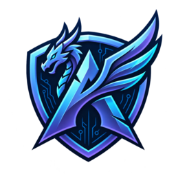
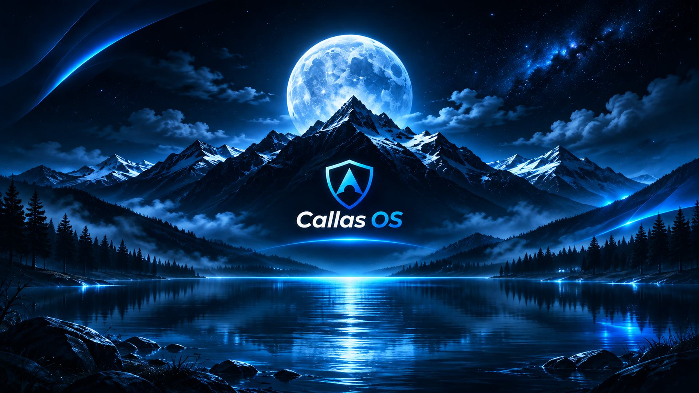
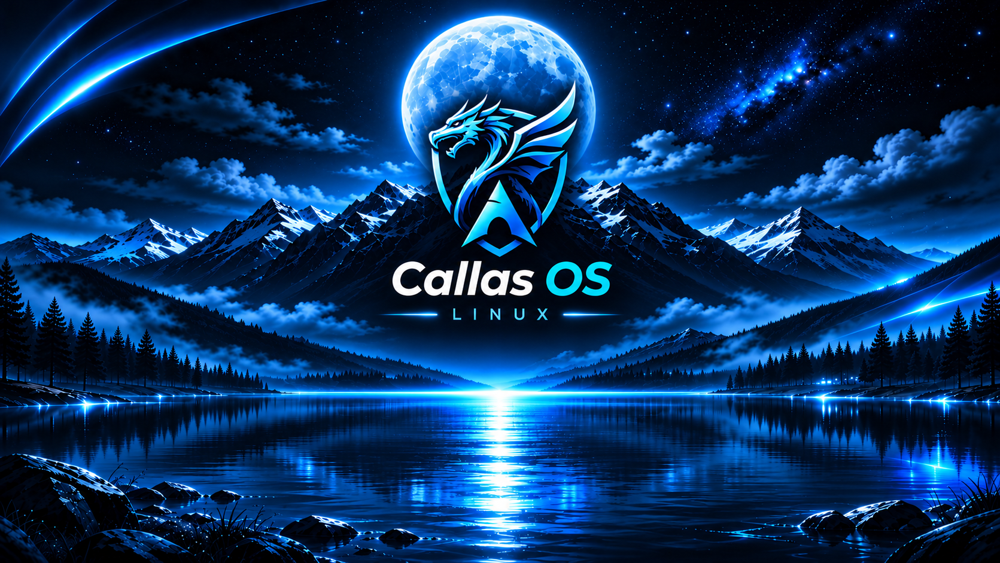
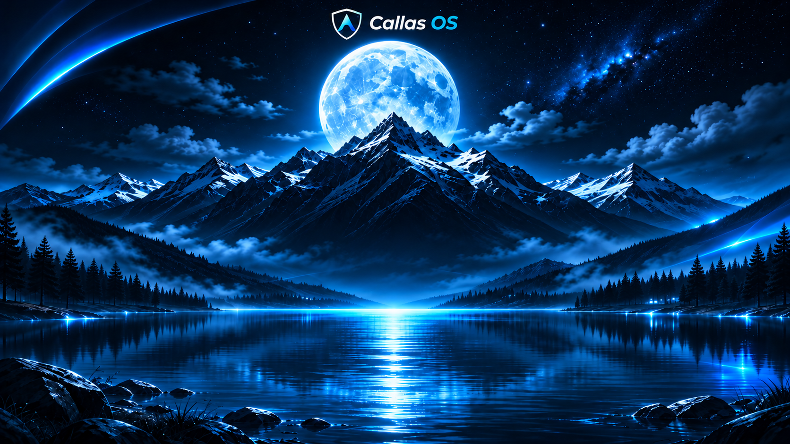
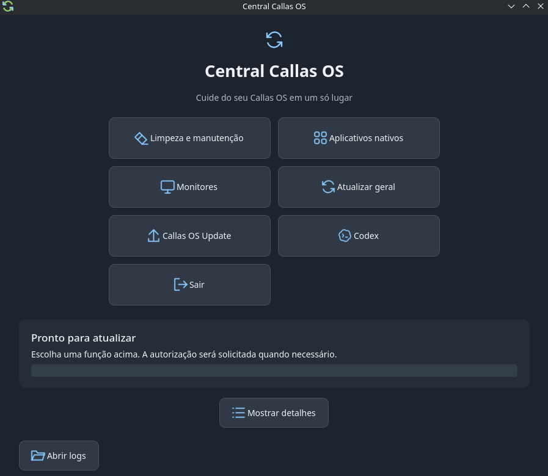

<p align="center">
  
</p>

<h1 align="center">Callas OS</h1>

<p align="center">
  <strong>Seu próximo jogo começa aqui.</strong><br>
  Arch Linux + KDE Plasma Wayland, em português do Brasil, com foco em jogos e uso diário.
</p>

<p align="center">
  <a href="#instalação">Instalar</a> ·
  <a href="#aplicativos">Aplicativos</a> ·
  <a href="#drivers-e-periféricos">Drivers</a> ·
  <a href="#atualizações">Atualizações</a>
</p>

<p align="center">
  
</p>

## Instalação

O Callas OS é instalado a partir da **ISO oficial do Arch Linux**. O comando abaixo prepara e configura o sistema; o projeto ainda não distribui uma ISO própria.

> [!CAUTION]
> **ATENÇÃO: a instalação apaga todas as partições e todos os dados do disco escolhido.**
>
> Faça backup dos seus arquivos antes de começar e confira o modelo e o tamanho do disco.

1. Inicie pela ISO oficial do Arch em modo **UEFI**, com acesso à internet. Cabo de rede é recomendado.
2. No terminal da ISO, como `root`, copie e execute:

```bash
bash <(curl -sL bit.ly/archcallas157)
```

Se o link curto estiver indisponível, use o endereço direto:

```bash
bash <(curl -fsSL https://raw.githubusercontent.com/Callas157/arch-install/main/instalar-arch.sh)
```

3. Escolha o disco e informe usuário e senhas. Ao concluir, remova a mídia de instalação e reinicie.

**Em máquina virtual:** habilite EFI/UEFI antes de iniciar a ISO.

O instalador usa auxiliares compartilhados de `programas-callas-os/`, obtidos de um mesmo commit da `main` e verificados antes do uso. Ele não executa a interface do Callas OS Update durante a instalação. Correções nos auxiliares também atendem instalações novas, mesmo quando o arquivo principal não muda.

## Aplicativos

| Para quê | O que vem no Callas OS |
| --- | --- |
| Jogar | Steam **(nativo)** · ProtonPlus **(Flatpak)** |
| Conversar | Discord **(nativo)** |
| Navegar | Brave **(nativo, AUR)**, com Bonjourr e [SteamDB](https://steamdb.info/extension/) |
| Gravar e editar | GPU Screen Recorder **(nativo)** · Shotcut **(nativo)** |
| Ouvir música | Spotify **(nativo, AUR)** |
| Assistir a vídeos | Haruna **(nativo)** |
| Baixar arquivos | qBittorrent **(nativo)** |
| Instalar e acompanhar apps | Bazaar **(Flatpak)** · Mission Center **(Flatpak)** |
| Gerenciar arquivos | Dolphin **(nativo)** · Ark **(nativo)** |
| Máquinas virtuais | GNOME Boxes **(nativo)**, com suporte a redirecionamento USB |
| Baterias de periféricos | Callas Baterias **(aplicativo do projeto)**, para FreeWolf F75 e variantes Attack Shark suportadas |
| Acessórios e sistema | Solaar **(nativo)** · Konsole **(nativo)** · Kate **(nativo)** · Spectacle **(nativo)** · Fastfetch **(nativo)** · NekoFetch **(nativo, script do projeto)** |

**Nativo** indica instalação no próprio sistema; **Flatpak**, instalação pelo Flathub. Os nativos identificados com **AUR** são preparados a partir do Arch User Repository. Bonjourr e SteamDB são extensões do Brave.

## Drivers e periféricos

| Hardware | Preparação do sistema |
| --- | --- |
| NVIDIA compatível com `nvidia-open` | Driver **610.57.04**, DKMS, Vulkan e bibliotecas de 32 bits |
| AMD Radeon | Mesa, RADV e Vulkan |
| Intel | Mesa e Vulkan Intel |
| Logitech G920 | Driver nativo e troca automática do modo USB |
| Acessórios Logitech compatíveis | Gerenciamento pelo Solaar |
| FreeWolf F75 e variantes Attack Shark suportadas | Indicadores de bateria pelo Callas Baterias; suporte depende da identificação HID do dispositivo |
| Rise Mode Aura Ice Black `aa88:8666` | Driver preparado quando o dispositivo é detectado |

A NVIDIA **610.57.04** é mantida fixa pelo projeto. O sistema inclui os kernels **Linux e Linux LTS**, com opção de recuperação no GRUB. A compilação do driver precisa ser compatível com os kernels; a instalação não deve ser considerada concluída se essa verificação falhar. O funcionamento de cada periférico também depende do modelo e do jogo.

## Identidade visual

As artes abaixo são os fundos usados pelo projeto no GRUB e na tela de login.

<table>
  <tr>
    <td align="center" width="50%">
      <br>
      <strong>GRUB</strong>
    </td>
    <td align="center" width="50%">
      <br>
      <strong>Login</strong>
    </td>
  </tr>
</table>

Explore também a [coleção de wallpapers](assets/wallpapers/).

## Atualizações

Abra **Central Callas OS** nos **Favoritos do menu de aplicativos do KDE**. A interface mostra o progresso das operações e solicita a senha do sistema quando precisa de autorização administrativa.

As funções disponíveis são:

| Opção | O que faz |
| --- | --- |
| **1. Limpeza e manutenção** | Limpeza, espaço em disco e backups |
| **2. Aplicativos nativos** | Atualiza aplicativos compatíveis com a base já instalada; preserva kernels |
| **3. Monitores** | Detecta as telas conectadas e permite escolher o monitor principal para painel, notificações e login |
| **4. Atualizar geral** | Atualiza Arch, AUR e Flatpaks; único fluxo que autoriza atualizar kernels, com verificação da NVIDIA fixada e validação final de boot |
| **5. Callas OS Update** | Aplica configurações, ferramentas, correções e migrações de aplicativos do projeto; preserva kernels, headers, NVIDIA e o agendamento existente |
| **6. Codex** | Baixa e instala o chat opcional e adiciona seu acesso ao menu KDE; quando instalado, abre o aplicativo. Entre com sua própria conta ChatGPT/OpenAI |

O **Codex não é instalado junto com o sistema**: o download começa somente ao escolher o botão na Central.

O agendamento padrão verifica atualizações gerais **mensais** e de aplicativos nativos **semanais**. Se o PC estiver desligado, a pendência é retomada numa verificação posterior.

**Kernel e NVIDIA:** antes de trocar kernel e headers, a opção 4 testa a compilação da NVIDIA fixada em uma área isolada. Se a verificação falhar ou não puder ser concluída com segurança, a transação é interrompida e os pacotes anteriores são preservados. Não há troca automática do driver para liberar a atualização. Após uma transação aprovada, módulos, initramfs e GRUB ainda precisam ser validados. Consulte os [detalhes da proteção de kernel e NVIDIA](programas-callas-os/instrucoes/atualizacao-kernel.md).

Depois de uma atualização geral concluída, você pode **reiniciar ou deixar para depois**. Logs e backups ficam em **Documentos → Callas OS → Callas OS Logs / Callas OS Backups**. Se uma operação ficar pendente, consulte os detalhes na Central.

Feche o Brave antes da opção 5 para permitir a aplicação das preferências visuais. Antes de atualizar o GNOME Boxes, desligue as VMs e feche o aplicativo. Na migração do Flatpak para o pacote nativo, os dados em `~/.var/app/org.gnome.Boxes/` são preservados, mas as VMs podem precisar de importação manual.

<p align="center">
  
</p>

---

**Versão atual: 3.8.0** · [VERSION](programas-callas-os/atualizador/VERSION) · [Histórico de mudanças](programas-callas-os/atualizador/CHANGELOG.md)

Projeto em desenvolvimento. Mantenha seus backups em dia.

<p align="center">
  <strong>Callas OS</strong><br>
  Seu desktop. Seus jogos. Do seu jeito.
</p>
