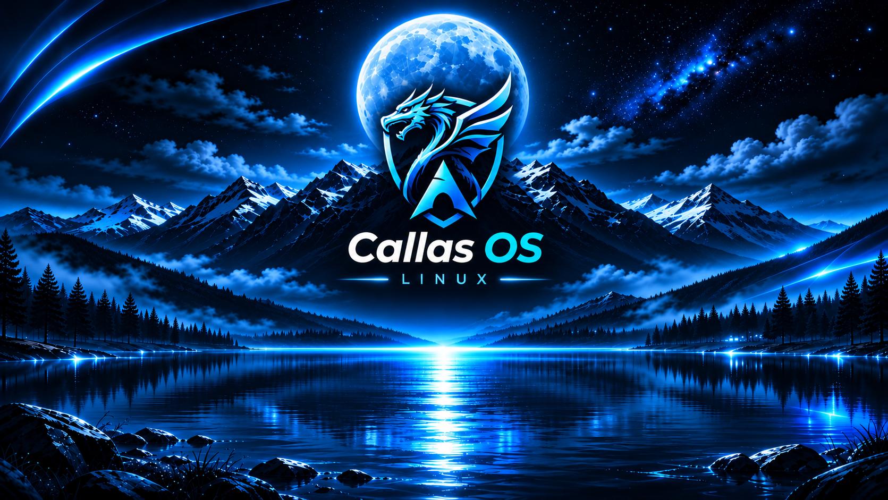
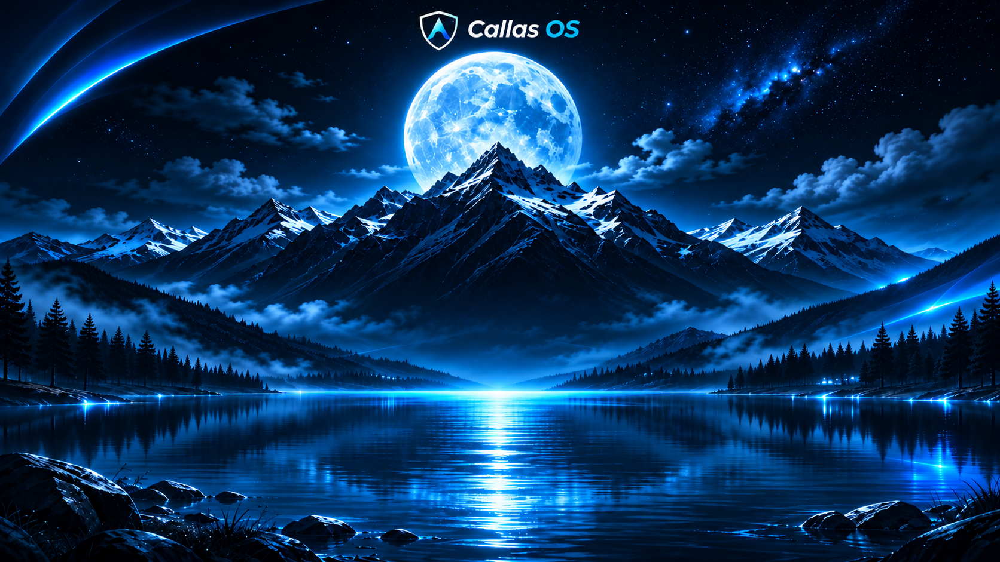
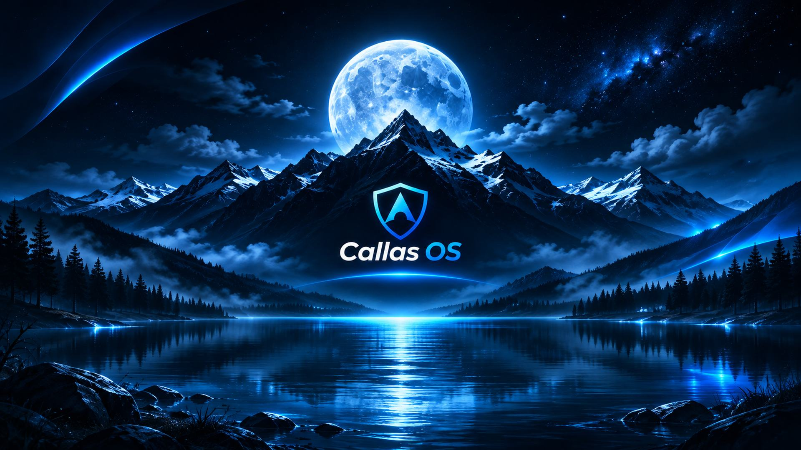

<p align="center">
  
</p>

<h1 align="center">Callas OS</h1>

<p align="center">
  Instalador automatizado de <strong>Arch Linux + KDE Plasma Wayland</strong>, em português do Brasil, preparado para jogos, uso diário, gravação, periféricos e manutenção simplificada.
</p>

---

## Sobre o projeto

O **Callas OS** parte da **ISO oficial do Arch Linux** e automatiza uma instalação limpa do sistema.

O instalador detecta o hardware disponível, prepara os drivers compatíveis, instala o KDE Plasma em Wayland, configura o boot com GRUB, instala os aplicativos escolhidos para o sistema e aplica os ajustes necessários para o primeiro uso.

> [!CAUTION]
> **A instalação apaga todas as partições e todos os dados do disco escolhido.**
> Faça backup dos arquivos importantes e confira com atenção o disco selecionado antes de confirmar.

## Instalação

Inicie o computador pela **ISO oficial do Arch Linux**, em modo **UEFI**, com acesso à internet.

No terminal da ISO, como `root`, execute:

```bash
bash <(curl -sL bit.ly/archcallas157)
```

Se o link curto estiver indisponível, use diretamente o GitHub:

```bash
bash <(curl -fsSL https://raw.githubusercontent.com/Callas157/arch-install/main/instalar-arch.sh)
```

Em máquina virtual, habilite **EFI/UEFI** antes de iniciar a ISO.

Durante a instalação, o script solicita:

1. **Disco de destino**
2. **Nome do usuário**
3. **Senha do usuário e do root**

Quando aparecer **Instalação concluída**, remova a mídia de instalação e reinicie o computador.

---

## Boot e recuperação

O Callas OS utiliza **GRUB em UEFI** como bootloader.

<p align="center">
  
</p>

A configuração inclui:

- menu de boot com contagem de **3 segundos**;
- entrada principal usando o kernel Arch `linux`;
- kernel **Linux LTS** instalado como alternativa;
- entrada direta **Callas OS (kernel LTS - recuperação)**;
- entrada de diagnóstico sem Plymouth;
- caminho UEFI de fallback `EFI/BOOT/BOOTX64.EFI`.

O kernel normal permanece como padrão. Se uma atualização de kernel, NVIDIA ou DKMS impedir o boot normal, o usuário pode selecionar manualmente o **kernel LTS** no GRUB e iniciar o sistema por ele para fazer os reparos necessários.

Antes das atualizações mensais do sistema, o atualizador também guarda informações de recuperação, incluindo lista de pacotes, configuração de `/etc`, banco local do pacman e configuração do GRUB.

> [!NOTE]
> O sistema usa **ext4**. O recurso de recuperação não é um snapshot completo ou rollback automático do sistema.

---

## Hardware

### Processadores

O instalador detecta automaticamente processadores **AMD** e **Intel** e instala o microcódigo correspondente:

- `amd-ucode`
- `intel-ucode`

### Placas de vídeo

| Hardware | Configuração |
| --- | --- |
| **NVIDIA** | `nvidia-open`, `nvidia-open-lts`, utilitários NVIDIA, Vulkan e bibliotecas de 32 bits |
| **AMD Radeon** | Mesa, RADV e Vulkan Radeon |
| **Intel** | Mesa, ANV e Vulkan Intel |
| **VM / GPU genérica** | Mesa com renderização Vulkan virtual ou por software quando necessário |

Máquinas com mais de uma GPU também podem receber os componentes correspondentes a cada fabricante detectado.

### Rede e dispositivos

O instalador prepara automaticamente:

- **NetworkManager**
- Wi-Fi quando detectado
- suporte adicional para determinados adaptadores Broadcom
- **Bluetooth**
- regras e componentes necessários aos periféricos configurados pelo projeto

### Rise Mode

O dispositivo USB **Rise Mode Aura Ice Black `aa88:8666`** é detectado automaticamente.

Quando encontrado, o instalador prepara as dependências, compila o driver compatível e configura seu serviço. Se o dispositivo não existir naquela máquina, essa etapa é simplesmente ignorada.

---

## Sistema base

A instalação utiliza:

- tabela de partição **GPT**;
- partição EFI de **1 GiB** em FAT32;
- sistema principal em **ext4**;
- kernel `linux`;
- kernel de recuperação `linux-lts`;
- **zram**;
- **TRIM periódico**;
- sincronização automática de horário;
- fuso **America/Sao_Paulo**;
- idioma **Português do Brasil**;
- teclado **EUA Internacional**;
- pastas pessoais em português;
- `sudo` para o grupo `wheel`.

---

## KDE Plasma

O ambiente gráfico é o **KDE Plasma em Wayland**, com tema escuro e uma sessão inicial preparada pelo instalador.

<p align="center">
  
</p>

Entre os ajustes aplicados estão:

- **Brisa Escuro**;
- SDDM em Wayland;
- login concentrado no monitor principal em configurações com múltiplas telas;
- integração da **Carteira KDE** com o login;
- sessão vazia ao entrar no Plasma;
- atalho **Super + Shift + S** para captura retangular pelo Spectacle;
- redução do tempo de desligamento e reinicialização;
- Steam iniciando silenciosamente;
- Discord iniciando minimizado;
- Solaar disponível na bandeja;
- Digital Vibrance configurado quando suportado.

O wallpaper inicial do desktop também é instalado junto da coleção de wallpapers do projeto.

<p align="center">
  
</p>

---

## Aplicativos

O Callas OS instala ou prepara, entre outros:

| Categoria | Aplicativos |
| --- | --- |
| **Navegação** | Brave **[Nativo — AUR]** |
| **Comunicação** | Discord **[Nativo — Repo Arch]** |
| **Jogos** | Steam **[Nativo — Repo Arch]**, ProtonPlus **[Flatpak]** |
| **Gravação** | GPU Screen Recorder **[Nativo — AUR]** |
| **Vídeo** | Shotcut **[Nativo — Repo Arch]** |
| **Downloads** | qBittorrent **[Nativo — Repo Arch]** |
| **Música** | Spotify **[Nativo — AUR]** |
| **Periféricos** | Solaar **[Nativo — Repo Arch]** |
| **Sistema** | Mission Center **[Flatpak]**, Fastfetch **[Nativo — Repo Arch]**, Nekofetch **[Nativo — uv/Python]** |
| **Loja de aplicativos** | Bazaar **[Flatpak]** |
| **Arquivos** | Dolphin **[Nativo — Repo Arch]**, Ark **[Nativo — Repo Arch]** |

O **Mission Center** é instalado pelo Flathub e funciona como o gerenciador gráfico de processos e desempenho do sistema.

O **Discord** instalado é o cliente padrão, sem BetterDiscord.

O **Spotify** instalado é o cliente padrão, sem Spicetify.

---

---

## Atualizações automáticas

O Callas OS inclui um **Atualizador do sistema** acessível pelo menu do KDE.

Existem duas rotinas automáticas:

| Rotina | Frequência | Conteúdo |
| --- | --- | --- |
| **Aplicativos** | A cada **7 dias** | Flatpaks + atualização própria do Discord |
| **Sistema** | A cada **1 mês** | Atualização completa do Arch via pacman + pacotes AUR via Paru, incluindo os aplicativos nativos instalados por esses meios |

Não existe horário fixo nem um dia fixo do mês.

Os vencimentos são calculados a partir da instalação e, depois disso, a partir da última atualização concluída com sucesso.

A agenda é verificada:

- pouco depois do boot;
- periodicamente enquanto o computador permanece ligado.

Se o computador estiver desligado no dia em que uma atualização vencer, ela continua pendente. No primeiro boot ou verificação seguinte, a atualização roda automaticamente.

Os aplicativos nativos instalados pelos repositórios do Arch ou pelo AUR acompanham a atualização mensal completa do sistema. Eles não são atualizados isoladamente na rotina semanal, porque o Arch Linux não dá suporte a atualizações parciais do sistema.

Quando a atualização semanal termina com sucesso, o KDE mostra uma notificação informando que os aplicativos foram atualizados.

Quando a atualização mensal termina com sucesso, o KDE apresenta uma notificação oferecendo:

- **Reiniciar agora**
- **Mais tarde**

Os registros ficam em:

`Documentos/Logs de Atualizações/atualizacoes.log`

Também é possível executar manualmente pelo Atualizador do sistema:

- atualização dos aplicativos;
- atualização completa do Arch/AUR;
- atualização do Discord.

---

---

## Nekofetch e Fastfetch

O **Fastfetch** é instalado no sistema e o **Nekofetch** é preparado para aparecer automaticamente ao abrir um terminal Bash interativo.

O layout mostra informações como:

- sistema;
- kernel;
- desktop;
- resolução e taxa de atualização;
- CPU;
- GPU;
- driver gráfico;
- VRAM, quando disponível.

---

## Tratamento de falhas

As etapas essenciais da instalação interrompem o processo quando ocorre um erro grave, incluindo:

- particionamento;
- criação dos sistemas de arquivos;
- instalação do sistema base;
- configuração do boot;
- geração do GRUB.

Componentes opcionais podem registrar um aviso e permitir que a instalação principal continue.

Os avisos ficam disponíveis em:

`/var/log/callas-instalacao-avisos.log`

---

## Principais recursos

- Arch Linux
- KDE Plasma Wayland
- GRUB UEFI
- kernel Linux + Linux LTS de recuperação
- Plymouth
- NVIDIA, AMD e Intel
- Steam e Vulkan
- ProtonPlus
- GPU Screen Recorder
- Mission Center
- Discord
- Spotify
- Solaar
- Xbox Wireless / xone
- detecção do Rise Mode
- Paru + AUR
- Flatpak + Flathub
- Fastfetch + Nekofetch
- atualizações automáticas
- notificação de reinicialização após atualização mensal

---

<p align="center">
  <strong>Callas OS</strong><br>
  Arch Linux preparado para instalar, iniciar e usar.
</p>
