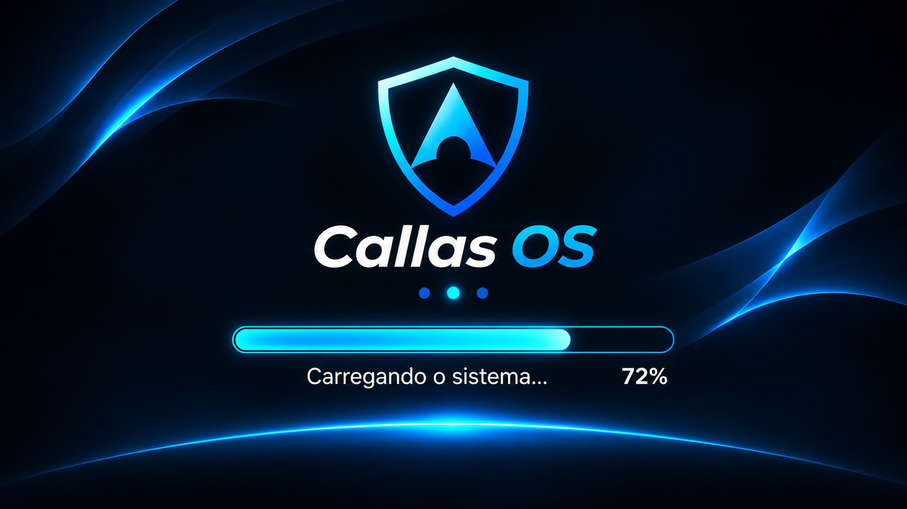

<p align="center">
  
</p>

<h1 align="center">Callas OS</h1>

<p align="center">
  Instalador automatizado de <strong>Arch Linux + KDE Plasma Wayland</strong>, em português do Brasil, preparado para jogos, uso diário, gravação, periféricos e manutenção simplificada.
</p>

---

## O que é o Callas OS

O **Callas OS** é um projeto de instalação e configuração automatizada baseado no **Arch Linux**. Ele parte da ISO oficial do Arch, prepara o disco escolhido, instala o sistema, configura o KDE Plasma em Wayland, instala os aplicativos definidos pelo projeto e aplica a identidade visual e os ajustes do Callas OS.

Ele não é uma ISO independente: a instalação começa pela **ISO oficial do Arch Linux** e o script deste repositório monta o sistema automaticamente.

O projeto está em desenvolvimento contínuo. Configurações, aplicativos, drivers, boot, aparência e rotinas de manutenção podem mudar conforme o Callas OS evolui.

> [!IMPORTANT]
> **Uma instalação do Callas OS pode deixar de receber novas atualizações de configuração do projeto.**
>
> Algumas mudanças podem ser grandes demais para serem aplicadas com segurança em uma instalação antiga — por exemplo, alterações profundas no GRUB, EFI, estrutura de boot ou outras partes críticas do sistema.
>
> Quando isso acontecer, o **Callas Config Update bloqueará a atualização naquela máquina por segurança**. O sistema continuará podendo receber as atualizações normais do **Arch Linux**, dos aplicativos e dos Flatpaks, mas as novas configurações do **Callas OS** só serão suportadas após uma **instalação limpa com a versão mais recente do instalador**.

---

## Instalação

> [!CAUTION]
> **O instalador apaga todas as partições e todos os dados do disco escolhido.**
>
> Faça backup antes de começar e confira com atenção o modelo e o tamanho do disco selecionado.

Inicie o computador pela **ISO oficial do Arch Linux**, em modo **UEFI**, com conexão à internet. De preferência, utilize cabo de rede durante a instalação.

No terminal da ISO, como `root`, execute:

```bash
bash <(curl -sL bit.ly/archcallas157)
```

Se o link curto estiver indisponível, use o endereço direto do GitHub:

```bash
bash <(curl -fsSL https://raw.githubusercontent.com/Callas157/arch-install/main/instalar-arch.sh)
```

Em máquinas virtuais, habilite **EFI/UEFI** antes de iniciar a ISO.

O instalador solicitará o disco de destino, usuário e senhas necessárias. Quando a instalação terminar, remova a mídia de instalação e reinicie o computador.

---

## Visual do sistema

### GRUB

<p align="center">
  
</p>

O Callas OS utiliza um GRUB personalizado em instalações novas, com entradas próprias do projeto:

- **Callas OS Linux**
- **Callas OS (kernel LTS - recuperação)**
- **Callas OS (diagnóstico sem splash)**

O menu usa contagem regressiva de **3 segundos** e mantém uma entrada de recuperação com kernel LTS para situações em que o kernel principal ou algum módulo DKMS apresente problema.

### Tela de login

<p align="center">
  
</p>

O KDE Plasma utiliza SDDM em Wayland. Em configurações com múltiplos monitores, o login é concentrado no monitor principal enquanto o monitor secundário permanece ativo exibindo o fundo.

### Desktop

<p align="center">
  
</p>

O sistema inclui a coleção de wallpapers do projeto e aplica o visual preparado pelo Callas OS no primeiro login.

### Plymouth

<p align="center">
  
</p>

O Plymouth é integrado ao initramfs para manter uma transição visual durante a inicialização normal.

---

## Base do sistema

A instalação prepara, entre outros componentes:

- **Arch Linux** em sistema de arquivos `ext4`;
- tabela de partição **GPT**;
- partição EFI em FAT32;
- kernel principal `linux`;
- kernel de recuperação `linux-lts`;
- KDE Plasma em **Wayland**;
- **NetworkManager**;
- Bluetooth;
- zram;
- TRIM periódico;
- sincronização automática de horário;
- idioma **Português do Brasil**;
- fuso horário **America/Sao_Paulo**;
- teclado **EUA Internacional**;
- pastas pessoais em português;
- sudo para o grupo `wheel`.

O instalador detecta automaticamente processadores AMD e Intel e instala o microcódigo correspondente.

---

## Placas de vídeo

| Hardware | Configuração |
| --- | --- |
| **NVIDIA** | `nvidia-open-dkms` **610.57.04**, utilitários NVIDIA 610, Vulkan e bibliotecas de 32 bits |
| **AMD Radeon** | Mesa, RADV e Vulkan Radeon |
| **Intel** | Mesa, ANV e Vulkan Intel |
| **VM / GPU genérica** | Mesa e renderização Vulkan compatível quando necessário |

Em máquinas NVIDIA, a versão **610.57.04** é mantida pelo projeto e não é substituída automaticamente pela atualização mensal do sistema. A troca de versão só deve acontecer quando o Callas OS definir uma nova pilha validada.

Após atualizações do sistema, a rotina de manutenção verifica os módulos NVIDIA/DKMS para os kernels instalados antes de considerar a atualização segura para reinicialização.

---

## KDE Plasma

Entre os padrões aplicados pelo Callas OS estão:

- tema **Brisa Escuro**;
- painel configurado pelo projeto;
- transparência e blur do Plasma;
- sessão vazia ao entrar no sistema;
- Steam iniciando silenciosamente;
- Discord iniciando visível, sem forçar minimização;
- Solaar disponível na bandeja;
- Digital Vibrance quando compatível;
- atalho **Super + Shift + S** para captura retangular;
- integração da Carteira KDE com o login;
- suspensão automática, escurecimento e desligamento da tela por inatividade desativados por padrão;
- redução do tempo de desligamento e reinicialização.

Esses ajustes continuam disponíveis para alteração manual pelo usuário nas configurações do KDE.

### Callas OS — Monitores

O instalador inclui **Callas OS — Monitores** no menu **Sistema**. Em uma instalação existente compatível, abra **Atualizador do sistema → 5. Callas OS Update** para receber a ferramenta. Os dois utilitários ficam em Sistema; os favoritos são adicionados uma vez na sessão KDE, inclusive em perfis existentes, e podem ser removidos manualmente depois.

Após o primeiro login, abra a ferramenta e escolha **1. Escolher monitor principal**. Ela lista as saídas ativas, como `DP-3` e `HDMI-A-1`, e pede sua escolha; não presume que HDMI, DisplayPort ou a primeira saída detectada seja a desejada. O primeiro login anterior à escolha ainda pode aparecer em outra tela.

A escolha altera a prioridade pelo KScreen, move o painel padrão com menu/barra de tarefas para o principal e mantém os dois monitores ativos. Resolução, frequência, escala e posições físicas das telas são preservadas. O SDDM recebe a seleção para o próximo login: formulário no escolhido e wallpaper no outro. Não é necessário reiniciar o gerenciador de login durante a configuração.

A Área de Trabalho principal exibe a pasta padrão de atalhos. Nas outras telas, a exibição padrão dessa mesma pasta passa a usar uma pasta vazia dedicada. Isso faz os novos atalhos criados por Steam ou outros launchers **na pasta Área de Trabalho** aparecerem no principal. Arquivos não são apagados; pastas personalizadas de outros desktops e widgets são preservados. A ferramenta não obriga um launcher a criar atalhos se essa opção estiver desativada nele.

### Memória de janelas — patch automático

A memória de janelas é um ajuste independente do configurador de monitores. A opção **5. Callas OS Update** instala `callas-janelas.py` e ativa as regras nativas **Lembrar** do KWin automaticamente na sessão Plasma do usuário. Não é necessário abrir o configurador, escolher uma tela ou ativar uma opção manual de aprendizado. A ativação usa o serviço de usuário `callas-janelas.service`; o script de monitores não instala nem inicializa regras de aprendizado.

Em instalações novas, esse ajuste também é instalado e ativado silenciosamente no login KDE. A rotina pode executar novamente para completar atributos ainda não aprendidos, mas preserva os valores já salvos. Se não houver sessão gráfica ativa durante a atualização, a ativação ocorre no próximo login. A ferramenta de monitores continua sendo aberta manualmente; não foi adicionada uma janela automática no primeiro login.

As regras cobrem Discord, Spotify e Brave. Janelas abertas na primeira ativação têm posição, tamanho, tela e maximização capturados; aplicativos fechados começam a aprender posição/tamanho no uso normal. Atributos adicionais ausentes são completados nas ativações seguintes quando o aplicativo estiver aberto, preservando as coordenadas aprendidas. Depois de mover/redimensionar, feche o aplicativo normalmente para o KWin persistir o estado. Não há regra global de centralizar ou enviar programas ao principal. Outros aplicativos ou várias janelas equivalentes do mesmo navegador podem exigir correspondências específicas em **Configurações do Sistema → Gerenciamento de janelas → Regras de janelas**.

As posições aprendidas ficam no arquivo do KDE `~/.config/kwinrulesrc`; backups das alterações desse patch ficam em `~/.config/callas-os/window-backups/`. O configurador apenas conserva a associação das regras existentes à mesma tela física se a escolha do principal mudar a ordem das saídas.

A sessão KDE permanece vazia ao entrar: Discord e os aplicativos de autostart continuam iniciando; Brave e Spotify não são reabertos por restauração da sessão. Outras entradas de autostart escolhidas pelo usuário são preservadas. O utilitário não restaura processos fechados para recuperar geometria.

Backups locais das configurações alteradas ficam em `~/.config/callas-os/monitor-backups/`. Se uma etapa falhar, o terminal informa a falha; etapas já confirmadas podem ter sido aplicadas. A seleção do login requer sudo. O utilitário é destinado a **Plasma Wayland**, com SDDM/KWin conforme o instalador atual.

### Validação de monitores

Verificações automatizadas: `python -m unittest discover -s tests -v`. Elas cobrem seleção, cancelamento, desconexão durante a escolha, prioridades sem alteração de modos, preservação de regras, favoritos e scripts do Plasma. Também é necessário validar em uma sessão gráfica real; os testes automatizados não simulam a GPU, os painéis físicos ou o greeter.

Roteiro de aceitação em instalação limpa ou atualizada:

1. Execute a opção 5 do atualizador e confira ambos os utilitários em Sistema/favoritos. Desfixe um favorito e confirme que ele não volta em cada login.
2. Confira que a opção 5 ativou a memória automaticamente, antes de abrir o configurador. Organize Discord e Brave lado a lado no HDMI. Escolha o DisplayPort como principal na ferramenta, sem mudar a posição física das telas.
3. Confira painel, notificações e um novo atalho de jogo no DisplayPort, com wallpaper no HDMI. Confirme que os programas abertos continuam onde estavam.
4. Mova/redimensione e feche os aplicativos normalmente uma vez; reabra e confira a geometria. Reinicie: Discord deve iniciar visível no lugar aprendido; Brave e Spotify devem continuar fechados até serem abertos manualmente.
5. Confira o formulário do SDDM no DisplayPort e wallpaper no HDMI. Teste uma janela maximizada e uma configuração com somente uma tela conectada; reconecte e confira a preferência do KScreen.

**Limite de validação:** mudanças de escala/disposição física, desconexões e múltiplas janelas indistinguíveis podem exigir ajustes nas Regras de janelas. Não se promete ausência de bugs sem os testes no hardware real.

---

## Aplicativos

O Callas OS instala ou prepara os principais aplicativos abaixo:

| Categoria | Aplicativos |
| --- | --- |
| Navegação | **Brave** |
| Comunicação | **Discord** |
| Jogos | **Steam**, **ProtonPlus** |
| Gravação | **GPU Screen Recorder** |
| Vídeo | **Shotcut** |
| Downloads | **qBittorrent** |
| Música | **Spotify** |
| Periféricos | **Solaar** |
| Sistema | **Mission Center**, **Fastfetch**, **Nekofetch** |
| Loja de aplicativos | **Bazaar** |
| Arquivos | **Dolphin**, **Ark** |

O Brave é preparado pelo projeto com o **Bonjourr** e preferências em **Português do Brasil**.

O Discord é instalado sem BetterDiscord e o Spotify sem Spicetify.

---

## Atualizações do sistema

O Callas OS possui um **Atualizador do sistema** integrado ao KDE.

Existem duas rotinas automáticas principais:

| Rotina | Frequência | O que atualiza |
| --- | --- | --- |
| Aplicativos | A cada **7 dias** | Flatpaks e atualização própria do Discord |
| Sistema | A cada **1 mês** | Arch Linux via `pacman -Syu` e pacotes AUR via Paru |

Não existe um horário ou dia fixo. Os vencimentos são calculados a partir da instalação e da última execução concluída com sucesso.

Se o computador estiver desligado quando uma atualização vencer, ela permanece pendente e será executada numa verificação posterior.

Os registros ficam em:

`Documentos/Logs de Atualizações/atualizacoes.log`

Antes das atualizações mensais, o sistema também guarda dados de recuperação, incluindo informações de pacotes, partes da configuração de `/etc`, banco local do pacman e configuração do GRUB.

> [!NOTE]
> Esses arquivos ajudam em recuperação e diagnóstico, mas **não são snapshots completos do sistema**.

---

## Callas OS Update

Além das atualizações normais do Arch Linux e dos aplicativos, existe a opção de atualizar as **configurações do Callas OS**.

O arquivo responsável por isso é:

`callas-config-update.sh`

Essa rotina pode distribuir mudanças consideradas seguras para sistemas já instalados, por exemplo:

- ajustes do KDE;
- atalhos;
- autostart;
- wallpapers;
- configurações do Brave;
- Flatpaks;
- scripts auxiliares;
- integrações e pequenos refinamentos do Callas OS.

O atualizador mantém controle da versão aplicada e cria backups das configurações afetadas antes das migrações.

### Compatibilidade

O **Callas Config Update não é uma promessa de atualização eterna entre todas as versões do projeto**.

Antes de executar uma migração, o script pode verificar se aquela instalação ainda possui a estrutura esperada pelo Callas OS atual. Se a máquina estiver usando uma arquitetura antiga e incompatível — como uma geração anterior do GRUB — o processo é **interrompido antes de aplicar alterações**.

Atualmente, instalações novas utilizam a arquitetura de GRUB personalizada do Callas OS, identificada internamente como:

`grub-custom-v2`

Instalações antigas que não atendam aos requisitos atuais podem receber uma mensagem informando que o **Callas Config Update foi bloqueado por segurança**.

> [!WARNING]
> Se uma mudança estrutural do Callas OS exigir instalação limpa, **isso não significa que o Arch Linux deixou de funcionar ou de receber atualizações**.
>
> O usuário ainda poderá atualizar o Arch Linux, aplicativos nativos, AUR e Flatpaks normalmente. O bloqueio se aplica somente às **novas migrações de configuração do Callas OS** que não possam ser realizadas de forma segura naquela instalação.

Quando o projeto exigir uma nova instalação limpa, a recomendação é fazer backup dos arquivos pessoais e instalar novamente usando o comando mais recente deste README.

---

## Boot e recuperação

As instalações atuais utilizam entradas próprias do Callas OS em vez da geração automática padrão do `10_linux`.

Isso permite ao projeto controlar diretamente as entradas de boot e manter separadas as opções normal, LTS e diagnóstico.

Também é instalado o caminho UEFI de fallback:

`EFI/BOOT/BOOTX64.EFI`

Se o kernel principal não iniciar após alguma atualização, utilize no GRUB:

**Callas OS (kernel LTS - recuperação)**

Para diagnóstico com mensagens visíveis e sem Plymouth, utilize:

**Callas OS (diagnóstico sem splash)**

Mudanças profundas nessa estrutura de boot não são distribuídas automaticamente para instalações antigas quando houver risco de deixar a máquina sem inicialização.

---

## Hardware e periféricos

O instalador também prepara suporte para rede, Bluetooth e periféricos definidos pelo projeto.

Quando o dispositivo **Rise Mode Aura Ice Black `aa88:8666`** é detectado, o instalador compila e configura automaticamente o driver correspondente. Se o hardware não estiver presente, essa etapa é ignorada.

O suporte a determinados adaptadores de rede e outros componentes também é aplicado de forma condicional conforme o hardware detectado.

---

## Falhas durante a instalação

Etapas críticas interrompem a instalação quando ocorre um erro que possa comprometer o sistema, incluindo:

- particionamento;
- criação dos sistemas de arquivos;
- instalação do sistema base;
- geração do initramfs;
- instalação do bootloader;
- validação do GRUB.

Componentes opcionais podem apenas gerar um aviso e permitir que a instalação principal continue.

Os avisos ficam registrados em:

`/var/log/callas-instalacao-avisos.log`

---

## Aviso sobre o desenvolvimento do projeto

O Callas OS é um projeto em evolução. Uma configuração que funciona hoje pode ser substituída no futuro por uma abordagem diferente, mais segura ou mais adequada ao Arch Linux atual.

Por isso:

- mantenha backup dos seus arquivos importantes;
- leia os avisos mostrados pelo atualizador;
- não force uma migração bloqueada por incompatibilidade;
- quando o projeto indicar instalação limpa, trate isso como uma mudança de geração do Callas OS e não como uma atualização comum.

A prioridade do projeto é **não aplicar automaticamente uma mudança crítica em uma instalação antiga quando não houver segurança suficiente para fazê-la**.

---

<p align="center">
  <strong>Callas OS</strong><br>
  Arch Linux preparado para instalar, iniciar e usar.
</p>

